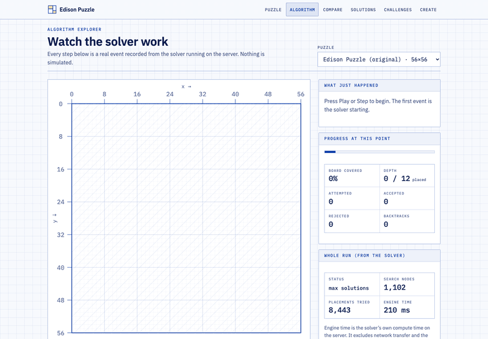
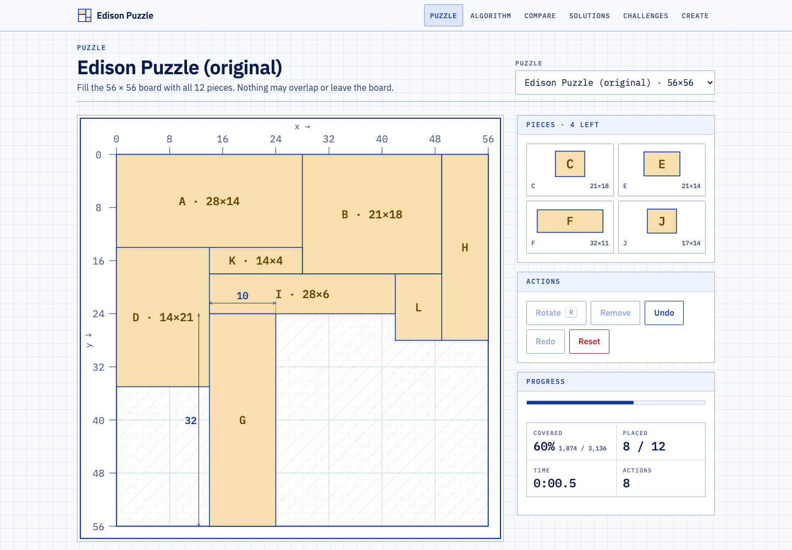
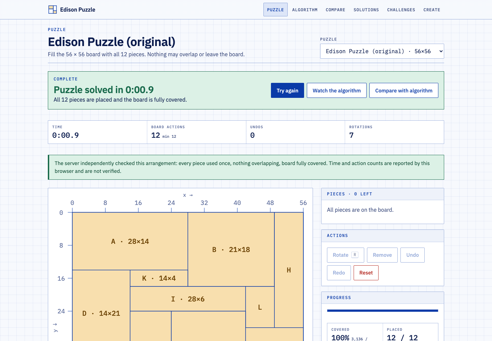
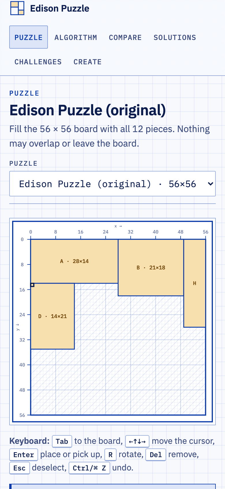
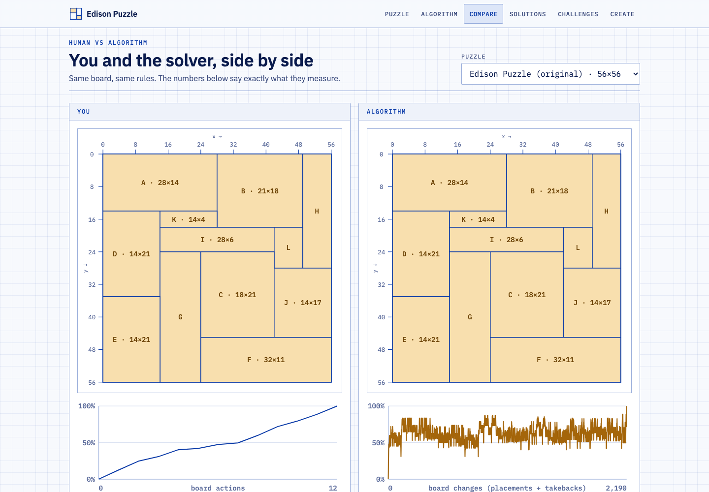
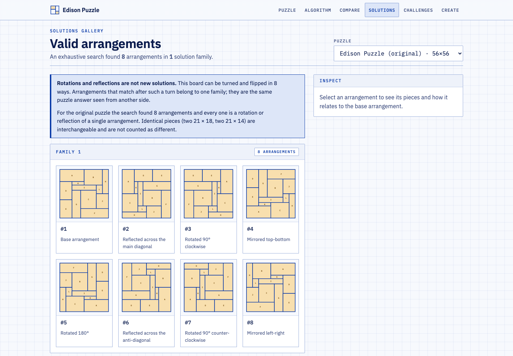
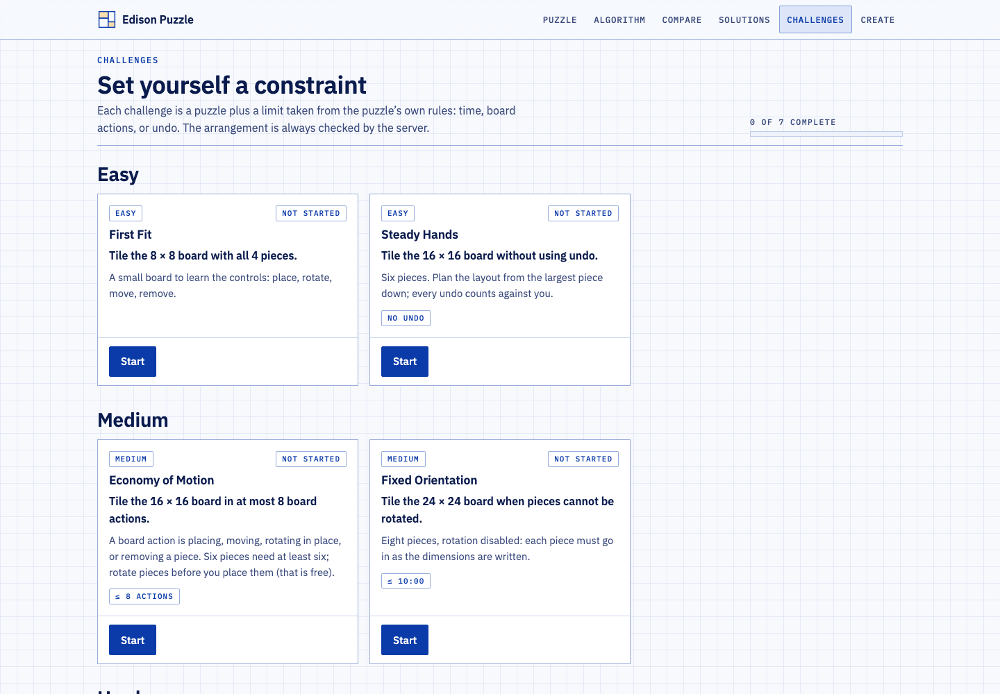
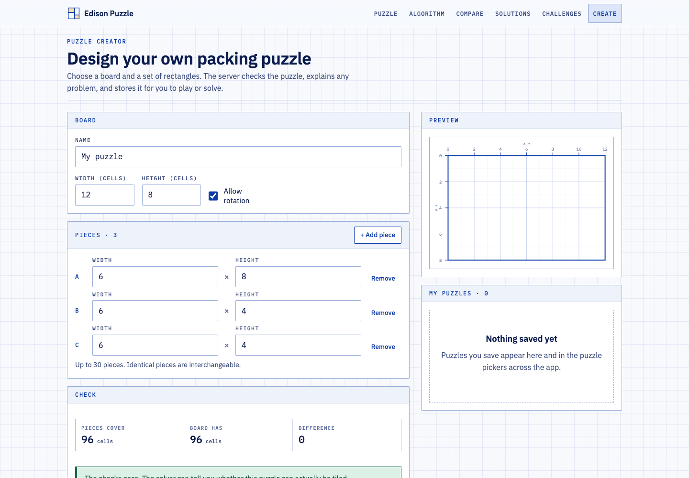

# Edison Puzzle

**Twelve rectangles. One 56 × 56 board. No gaps, no overlaps.**

Edison Puzzle is a web app built around a deceptively simple packing puzzle: fit twelve differently sized rectangles exactly into a square. You can solve it yourself, then watch a real backtracking solver attack the same board, event by event, and compare the two.



*The Algorithm Explorer replaying a real solver run: the search wanders, backs out of dead ends, and lands on the solution. Nothing is simulated.*

> **Status:** implemented and covered by automated tests (335 backend, 154 frontend, 62 end-to-end). It has **not** been through human acceptance testing and is **not deployed**. There is no project licence yet; see [Licence and attribution](#licence-and-attribution).

## The problem

The twelve pieces have areas that sum to exactly 3,136 = 56². There is no spare space, so one misplaced rectangle ruins everything, and the pieces can be rotated, which roughly doubles the choices at every step. It is easy to get nine or ten pieces down and then discover the last few cannot fit.

## The puzzle experience

| Playground | Finished and verified |
|---|---|
|  |  |

Place, move, rotate and remove pieces with the mouse, a touch screen, or the keyboard alone (drag is an extra, never a requirement). The board shows a live preview and the reason when a placement is invalid. Undo and redo are built in. When the board is full, the **server independently re-checks the arrangement**: every piece used once, nothing overlapping, nothing outside the board.

On a phone the same board fits the screen:



## The algorithmic challenge

The solver is a depth-first backtracking search with one key idea: **the first empty cell, scanning row by row, must be the top-left corner of some piece in any complete tiling.** So at each step the solver only tries placements anchored at that cell. That makes the search *complete* (no tiling can be skipped) and stops it from trying the same set of pieces in different orders.

Two further choices keep it honest and fast:

- **Interchangeable pieces are one branch.** The puzzle has two 21 × 18 pieces and two 21 × 14 pieces; trying "piece A here, then piece B" and "B here, then A" is wasted work. Identical pieces (up to rotation, when rotation is allowed) share a branch.
- **Undo in place.** One mutable board stored as a bitmask per row, with place and remove operations, instead of copying the grid at every node.

What exhaustive search established (asserted by tests, one of them a slow exhaustive run):

| Fact | Value |
|---|---|
| First solution | 1,102 search nodes, 8,443 placements tried, about 15 ms |
| Whole search space | 5,485,433 nodes, about 65 s on one machine |
| Number of solutions | **8**, which are one arrangement and its 8 rotations and reflections, i.e. **one solution family** |
| Without rotation | **no solution exists** |

The solver is a lazy generator of events (`solver_started`, `piece_selected`, `placement_attempted`, `placement_rejected`, `placement_accepted`, `backtrack_started`, `backtrack_completed`, `solution_found`, `search_completed`), so searching and rendering are fully separate. It is cross-checked against an independent brute-force oracle on small boards. Details: [docs/algorithm-design.md](docs/algorithm-design.md).

## What you can do

| Area | What it does |
|---|---|
| **Playground** | Solve the puzzle yourself; server-verified completion. |
| **Algorithm Explorer** | Streams the real solver's events and plays them forwards and backwards: step, scrub, jump to the next dead end or the solution. |
| **Human vs Algorithm** | Your run beside the solver's, with a note on what each measure does and does not mean. |
| **Solutions Gallery** | All 8 arrangements, grouped by rotation and reflection into 1 family. |
| **Challenges** | Seven rule-based challenges (no undo, a board-action budget, no rotation, a time limit), evaluated by the server. |
| **Puzzle Creator** | Design your own board and pieces; the server explains impossible setups, can solve them, and saves them. |

| Human vs Algorithm | Solutions Gallery |
|---|---|
|  |  |
| **Challenges** | **Puzzle Creator** |
|  |  |

## Product decisions worth explaining

- **Real events, not an animation.** The Explorer replays what the solver actually did. A full trace of the first solution is 23,291 events; sent naively with a board snapshot on each, that is about 19 MB. The API sends a *compact* encoding (accepted placements push, backtracks pop), about 3.5 MB, and the browser rebuilds each board state with checkpoints every 256 events so scrubbing stays fast. The replay is verified against snapshots generated by the Python engine.
- **Rotations and reflections are not new solutions.** A square board has 8 symmetries; counting them as 8 solutions would be misleading, so the gallery groups them into families and says so.
- **Honest about what can be verified.** The server verifies the *arrangement*. Solve time, action counts and undos are measured in the browser and cannot be verified, and the UI says so. Challenges are therefore "honest mode", not a leaderboard.
- **Bounded resource use.** Solver limits (nodes, time, events) are clamped on the server, only two searches run at once (extra requests get HTTP 429), and a client that disconnects mid-search cancels the search.
- **Accessible by construction.** Everything works by keyboard; pieces have text labels, not just colour; automated axe-core scans of the main pages report no WCAG A/AA violations. It has not been tried with real screen readers.
- **Technical-drawing look.** Light paper, a fine construction grid, cobalt linework, rulers and dimension annotations, a restrained amber for pieces, and IBM Plex Sans and Mono.

## Architecture

```
src/edison_puzzle/   framework-free engine: board, solver, events, validation, symmetry, challenges
src/edison_api/      FastAPI app, SQLite persistence, server-sent-event streaming
frontend/            React + TypeScript + Vite single-page app
shared/types/        the TypeScript contract for the API and the solver events
tests/               backend tests (pytest)
docs/                architecture, API, algorithm, data model, testing, deployment
```

- **Engine** never imports web code; the API never re-implements rules, it calls the engine.
- **API** is one FastAPI process that also serves the built frontend, with SQLite in WAL mode and one error format for every failure. Run exactly one worker: the concurrency cap and cancellation live in-process.
- **Frontend** keeps pure logic (`lib/`, `game/`, `explorer/`) apart from thin pages; the Playground's behaviour is one pure reducer.
- **Persistence:** puzzles, solutions and attempts live on the server; preferences, a game in progress and run history live in the browser. There are no accounts, only a random anonymous id.

Technology: Python 3.11+, FastAPI, SQLite; React 19, TypeScript, Vite, React Router; Vitest, Testing Library, Playwright, axe-core; ruff, mypy, ESLint, Prettier. More in [docs/architecture.md](docs/architecture.md).

## Quality

| Layer | Tests |
|---|---|
| Backend (engine, validation, API, contract) | 335, plus 2 slow exhaustive tests |
| Frontend logic and components | 154 |
| End-to-end (real server, production build, Chromium) | 62, including 21 responsive-layout checks and accessibility scans |

Lint, formatting and type checks are clean for both languages. A GitHub Actions workflow is included but has not yet run. See [docs/testing.md](docs/testing.md).

## Run it

Requirements: Python 3.11 or newer, Node 20 or newer.

```bash
make setup      # virtualenv, Python deps, npm ci, Playwright Chromium
make run        # builds the frontend and serves everything at http://127.0.0.1:8000
```

If port 8000 is already in use: `make run PORT=8001`.

For development, run `make dev-api` (API on :8000) and `make dev-web` (Vite on :5173, proxying `/api`). Other targets: `make check` (lint, types, unit and integration tests), `make e2e`, `make test-slow`. Full details in [docs/development.md](docs/development.md).

## Known limitations

- No accounts, rate limiting or authentication: writes are open, so a public deployment needs limits at a reverse proxy.
- The solver has no dead-space pruning, so a full search takes about a minute and hard custom puzzles may hit a limit and report "inconclusive".
- Tested on Chromium on macOS only; not tried with real assistive technology or real touch hardware.
- Not deployed, and no container image or hosting configuration yet.

The complete list is in [docs/engineering-handoff.md](docs/engineering-handoff.md).

## Documentation

[Product overview](docs/product-overview.md) · [Architecture](docs/architecture.md) · [API](docs/api-contracts.md) · [Algorithm](docs/algorithm-design.md) · [Data model](docs/data-model.md) · [Development](docs/development.md) · [Testing](docs/testing.md) · [Deployment](docs/deployment.md) · [UAT checklist](docs/uat-checklist.md) · [Licensing and security](docs/licensing.md) · [Handoff and limitations](docs/engineering-handoff.md) · [Original-code assessment](docs/technical-assessment.md)

## Licence and attribution

**This project currently has no licence**, which means all rights are reserved: you may read the code, but you have no permission to copy, modify or redistribute it. A licence may be added later.

**Attribution and an open question.** The puzzle comes from the repository [lnmangione/Edison-Puzzle](https://github.com/lnmangione/Edison-Puzzle), which also has no licence. None of its source code or solver output is included here; the engine, tests and application are an independent implementation of the same published idea (backtracking from the first free cell). The one thing shared with it is the puzzle definition: the 56 × 56 board and the twelve piece dimensions. These are puzzle facts rather than creative expression, but they were taken from that repository's list and permission has not been obtained, so the original puzzle is kept on that understanding, as a non-commercial portfolio project, and the question is **unresolved**. This project claims no ownership of the puzzle definition. Details: [docs/licensing.md](docs/licensing.md).
